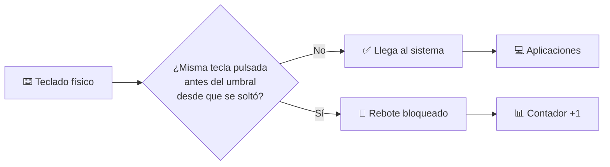

<div align="center">


# KORVEX Anti-Chatter

**Filtro anti-rebotes para teclados mecánicos, en Windows y Linux.**
Bloquea las pulsaciones dobles que producen los interruptores desgastados<br>
antes de que lleguen a ninguna aplicación.

[](../../releases/latest)
[](#-windows)
[](#-linux-debian--ubuntu)
[](#-cómo-funciona)
[](https://pypi.org/project/PyQt6/)
[](LICENSE)

[**Descargar**](../../releases/latest) · [Instalación](#-instalación) · [Uso](#-uso) · [Cómo funciona](#-cómo-funciona) · [Problemas](#-problemas-frecuentes)

</div>

---

## ✨ Características

<table>
<tr>
<td width="50%" valign="top">

### 🛡️ Filtrado real
- **Bloquea el rebote de verdad**: la pulsación repetida nunca llega al sistema (no se escribe y luego se borra)
- **Umbrales configurables** para las teclas y, aparte, para la barra espaciadora
- **Autorepetición intacta**: mantener una tecla pulsada funciona como siempre

</td>
<td width="50%" valign="top">

### 🎯 Preciso
- **Todas las teclas** (excepto Shift, Ctrl, Alt y Win/Super) **o solo las que fallan**
- **Contador de rebotes por tecla** para descubrir qué interruptor está mal
- **Respeta la autoescritura**: gestores de contraseñas, macros y AutoHotkey pasan sin filtrar

</td>
</tr>
<tr>
<td width="50%" valign="top">

### 🔒 Seguro
- **Sin root en Linux**: permisos solo para el usuario de la sesión activa
- **Suelta el teclado** si otro usuario inicia sesión en el equipo
- **Nunca guarda lo que escribes**: el registro solo anota arranques y errores

</td>
<td width="50%" valign="top">

### 🎨 Cómodo
- Interfaz oscura en **PyQt6**, en **español e inglés**
- **Bandeja del sistema** con pausa y reanudación
- **Inicio con el sistema** y arranque oculto
- **Actualizaciones automáticas** en Linux vía `apt`

</td>
</tr>
</table>

---

## 📥 Instalación

### 🐧 Linux (Debian / Ubuntu)

#### Repositorio APT (recomendado, se actualiza solo)

```bash
# 1. Clave pública del repositorio
wget -O- https://mikicolmena.github.io/KORVEX-Anti-Chatter/public.key | sudo gpg --dearmor -o /usr/share/keyrings/korvex.gpg

# 2. Añadir el repositorio
echo "deb [signed-by=/usr/share/keyrings/korvex.gpg] https://mikicolmena.github.io/KORVEX-Anti-Chatter stable main" | sudo tee /etc/apt/sources.list.d/korvex.list

# 3. Instalar
sudo apt update
sudo apt install korvex-antichatter
```

Listo: aparece en el menú de aplicaciones y las nuevas versiones llegan con `sudo apt update && sudo apt upgrade`.

> [!TIP]
> Si al abrirlo por primera vez dice que no tiene permiso para acceder al teclado, **cierra sesión y vuelve a entrar** una vez.

<details>
<summary><b>Instalar el .deb suelto (sin actualizaciones automáticas)</b></summary>

<br>

Descarga `korvex-antichatter_<versión>_all.deb` desde [**Releases**](../../releases/latest) e instálalo:

```bash
sudo apt install ./korvex-antichatter_*_all.deb
```

Usa `apt install ./archivo.deb` (con el `./`) en lugar de `dpkg -i`, así `apt` resuelve las dependencias por ti.

</details>

<details>
<summary><b>Otras distribuciones (Arch, Fedora, openSUSE…)</b></summary>

<br>

Desde el código fuente:

```bash
git clone https://github.com/mikicolmena/KORVEX-Anti-Chatter.git
cd KORVEX-Anti-Chatter
# Instala PyQt6 y python-evdev con el gestor de paquetes de tu distro, por ejemplo:
#   Arch:   sudo pacman -S python-pyqt6 python-evdev
#   Fedora: sudo dnf install python3-pyqt6 python3-evdev
python3 main.py
```

Sin el paquete `.deb` faltan los permisos sobre el teclado: la propia app te muestra los comandos para concederlos (grupo `input` y regla udev para `/dev/uinput`).

</details>

### 🪟 Windows

1. Descarga **`KorvexAntiChatter-windows.zip`** desde [**Releases**](../../releases/latest).
2. Descomprímelo donde quieras (por ejemplo, en `Documentos`).
3. Ejecuta `KorvexAntiChatter.exe` desde esa carpeta.

> [!WARNING]
> El ejecutable no está firmado digitalmente. Si aparece **SmartScreen**, pulsa *Más información → Ejecutar de todas formas*.
> Como el programa intercepta el teclado para filtrarlo, algunos **antivirus** pueden dar un falso positivo: no envía nada a ninguna parte ni guarda lo que escribes, y el código completo está en este repositorio.

### 📋 Requisitos

| Componente | Versión | Para qué |
|:--|:--|:--|
| Windows | 10 / 11 | Hook de teclado de bajo nivel |
| Debian / Ubuntu | 12+ / 22.04+ | Paquete `.deb` y repositorio APT |
| Python | ≥ 3.8 | Solo en Linux o ejecutando desde el código (el `.zip` de Windows lo incluye) |
| PyQt6 | ≥ 6.2 | Interfaz (`python3-pyqt6`) |
| python-evdev | ≥ 1.4 | Captura del teclado en Linux (`python3-evdev`) |
| systemd-logind | — | Permisos sin root en Linux (`uaccess`) |

---

## 🚀 Uso

| Paso | Dónde | Qué hacer |
|:--:|:--|:--|
| **1** | ▶️ **Botón principal** | El filtro arranca solo. En **verde** está activo; en **rojo**, en pausa. |
| **2** | ⏱️ **Umbrales** | Deja **50 ms** para las teclas y **120 ms** para el espacio. Pasa el ratón por encima para ver la ayuda. |
| **3** | 🔢 **Contador** | Escribe con normalidad: cada rebote bloqueado suma y se muestra la última tecla afectada. |
| **4** | 🎯 **Elegir teclas…** | Si solo fallan algunas teclas, márcalas y cambia a **«Solo las seleccionadas»**. |
| **5** | ⚙️ **Opciones** | Activa **inicio con el sistema** y **arrancar escondido** para olvidarte de él. |

> [!NOTE]
> - **¿Se cuelan letras dobles?** Sube el umbral poco a poco (de 10 en 10 ms).
> - **¿Desaparecen dobles legítimas** como «ll», «rr» o «cc»? Bájalo, o filtra solo las teclas que fallan.
> - Haz clic en el icono de la bandeja para mostrar u ocultar la ventana; con clic derecho puedes **pausar** el filtro.

---

## 🔀 Cómo funciona

Cuando un interruptor rebota, el sistema recibe *soltar → pulsar* de la misma tecla en muy pocos milisegundos. KORVEX mide ese hueco y descarta la pulsación fantasma **y su liberación**:



| Plataforma | Mecanismo |
|:--|:--|
| 🪟 **Windows** | Hook de teclado de bajo nivel (`WH_KEYBOARD_LL`) propio. Ignora las pulsaciones inyectadas por software. |
| 🐧 **Linux** | Captura exclusiva del teclado físico con **evdev** y reenvío de las pulsaciones válidas por un teclado virtual (**uinput**). Funciona igual en X11, Wayland y la consola. |

En Linux, el paquete instala una regla **udev** con la etiqueta `uaccess`: da acceso a los teclados y a `/dev/uinput` **solo al usuario de la sesión local activa**, así que no hace falta root ni contraseña. Si otro usuario pasa a tener la sesión activa, KORVEX suelta el teclado al momento.

La configuración se guarda en `~/.config/Korvex/AntiChatter.conf` (Linux) o en el registro de Windows (`HKCU\Software\Korvex\AntiChatter`).

---

## 🐛 Problemas frecuentes

<details>
<summary><b>Linux: «No hay permiso para acceder al teclado»</b></summary>
<br>
Justo después de instalar el <code>.deb</code>, <b>cierra sesión y vuelve a entrar</b>. Si sigue igual (o lo ejecutas desde el código fuente), la ventana de error muestra los comandos para añadirte al grupo <code>input</code> y permitir el acceso a <code>/dev/uinput</code>.
</details>

<details>
<summary><b>Linux (GNOME): no veo el icono en la bandeja</b></summary>
<br>
GNOME no muestra iconos de bandeja de serie. Ubuntu ya trae la extensión; en Debian, Fedora y otros instala <b>AppIndicator and KStatusNotifierItem Support</b> (en Debian: <code>sudo apt install gnome-shell-extension-appindicator</code>). Sin bandeja, «Minimizar» deja la ventana minimizada en la barra de tareas.
</details>

<details>
<summary><b>Windows: el filtro no funciona en algunas ventanas</b></summary>
<br>
Windows no deja que un programa normal intercepte el teclado en ventanas que se ejecutan <b>como administrador</b>. Si lo necesitas también ahí, ejecuta KORVEX como administrador.
</details>

<details>
<summary><b>Windows: el antivirus lo bloquea o lo pone en cuarentena</b></summary>
<br>
Es un falso positivo habitual en programas que interceptan el teclado y no están firmados. Puedes añadir una excepción para la carpeta de KORVEX o revisar el código fuente de este repositorio.
</details>

<details>
<summary><b>Se comen letras dobles que sí quería escribir</b></summary>
<br>
Baja el <b>umbral de teclas</b> (prueba con 30–40 ms) o usa el modo <b>«Solo las seleccionadas»</b> con las teclas que rebotan de verdad: en <b>Elegir teclas…</b> verás cuántos rebotes ha tenido cada una.
</details>

<details>
<summary><b>Algo raro pasa y quiero ver qué ocurre</b></summary>
<br>
Mira el registro de diagnóstico (nunca contiene lo que escribes):
<ul>
<li><b>Linux:</b> <code>~/.local/state/korvex-antichatter/korvex.log</code></li>
<li><b>Windows:</b> <code>%LOCALAPPDATA%\KorvexAntiChatter\korvex.log</code></li>
</ul>
Adjúntalo si <a href="../../issues">abres un issue</a>.
</details>

---

## 📂 Estructura

```
KORVEX-Anti-Chatter/
├── main.py                     # Punto de entrada
├── korvex/
│   ├── core.py                 # Lógica del filtro (independiente de la plataforma)
│   ├── gui.py                  # Interfaz PyQt6
│   ├── app.py                  # Arranque e instancia única
│   ├── autostart.py            # Inicio con el sistema
│   ├── i18n.py                 # Textos en español e inglés
│   ├── logs.py                 # Registro de diagnóstico
│   └── backends/
│       ├── linux_evdev.py      # Linux: evdev + uinput
│       └── windows_hook.py     # Windows: WH_KEYBOARD_LL
├── packaging/                  # .desktop, regla udev, scripts del .deb
├── tests/                      # Tests unitarios
├── build_deb.sh                # Genera el paquete .deb
└── LICENSE
```

---

## 🧑‍💻 Desarrollo

<details>
<summary><b>Ejecutar desde el código y pasar los tests</b></summary>

<br>

```bash
# Linux
sudo apt install python3-pyqt6 python3-evdev
python3 main.py

# Windows
pip install PyQt6
python main.py

# Tests (se ejecutan también en GitHub Actions con cada push)
python3 -m unittest discover -s tests -t . -v
```

</details>

<details>
<summary><b>Publicar una versión</b></summary>

<br>

Crea una **release** en GitHub con un tag que contenga el número de versión (`Version1.2`, `v1.2.0`…). El workflow:

1. Pasa los tests.
2. Construye el `.deb` y el `.zip` de Windows con esa versión.
3. Los adjunta a la release.
4. Actualiza el repositorio APT firmado en GitHub Pages.

**Firma del ejecutable de Windows (opcional):** añade en *Settings → Secrets and variables → Actions* los secretos `WINDOWS_CERT_PFX_BASE64` (certificado `.pfx` en base64) y `WINDOWS_CERT_PASSWORD`, y el workflow firmará `KorvexAntiChatter.exe` automáticamente.

</details>

---

## 🤝 Contribuir

¡Las contribuciones son bienvenidas! Para cambios grandes, abre antes un [issue](../../issues) y lo hablamos.

```bash
git checkout -b feature/mi-mejora
git commit -m "feat: descripción"
git push origin feature/mi-mejora
```

…y abre un **Pull Request**.

---

<div align="center">

Parte del ecosistema **KORVEX** · Licencia [MIT](LICENSE)

Hecho con ❤️ por [@mikicolmena](https://github.com/mikicolmena)

</div>
